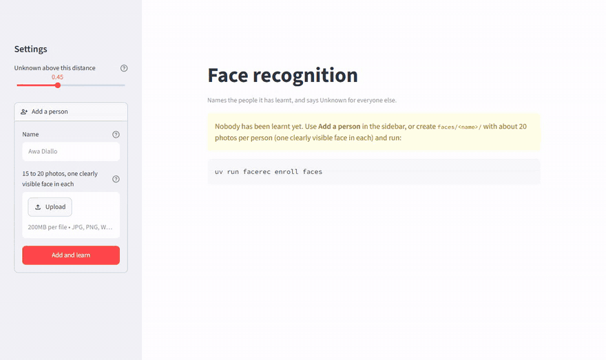

# 👤 Face recognition

[](https://github.com/Morissala2001/face-recognition-opencv-computer_vision/actions/workflows/tests.yml)

*Recognise the people you know in photos, videos and live cameras, and say "Unknown" for everyone else.*

**[▶ Try it online](https://face-recognition-morissala.streamlit.app/)** (free hosting: the first visit may take a minute to wake the app up.)


<sub>Two astronauts are learnt from older official portraits, then recognised on crew photos where the others are Unknown. Public-domain NASA photos from Wikimedia Commons.</sub>

Enrol a few people with about 20 photos each, then show a photo, a video, your webcam, your phone's camera or a network camera: every face gets a name, or **Unknown** when it is nobody you enrolled. It runs on a laptop CPU with **OpenCV only**: YuNet finds the faces and their landmarks, SFace turns each aligned face into 128 numbers, and a face is named after the closest enrolled face when it is close enough. The project has a **web app** (Streamlit), a **CLI** (`facerec`) and a small **library** (`src/facerec`), with an evaluation on the public LFW benchmark.

**Your photos stay on your machine.** The enrolled faces are personal (biometric) data: the `faces/` folder and the enrolled vectors are ignored by git, and the tests use synthetic images only.

**Online, nothing is kept either.** The online demo learns the faces a visitor adds in the memory of their session only: nothing is written to the server, other visitors never see them, and they are forgotten when the visitor leaves. Without photos of your own, it can be tried with public-domain NASA photos (`examples/`). The phone and stream source is not offered online: the server cannot see the visitor's phone. The app switches to this mode by itself on Streamlit Community Cloud (or with `FACEREC_PUBLIC=1`).

## Why YuNet + SFace

This project started from a YouTube tutorial that detects faces with YOLOv8-face and recognises them with OpenCV's LBPH (Local Binary Patterns Histograms) recognizer, with a fixed "Unknown" threshold of 65. Before building on it, I measured it on LFW with the protocol below, against two alternatives, on exactly the same scenarios:

| Method | Known person named right | Known person, wrong name | Stranger rejected | Time per photo |
|---|---|---|---|---|
| YOLOv8-face + LBPH, tutorial threshold (65) | 76.2% | 9.9% | **37.5%** | 59 ms |
| YOLOv8-face + LBPH, threshold chosen on LFW (54) | 52.0% | 3.6% | 87.1% | 59 ms |
| YuNet + LBPH | 51.8% | 3.4% | 86.5% | 4 ms |
| **YuNet + SFace** (this repository) | **96.6%** | **0%** | **99.95%** | 24 ms |

Times are per photo on a laptop CPU (Intel i7-13700H), detection and recognition, measured in the same run.

- With the tutorial's threshold, **two strangers out of three get the name of an enrolled person**.
- LBPH cannot do both jobs: a threshold that rejects strangers calls half of the known people Unknown.
- The detector is not the problem: YuNet gives the same LBPH accuracy as YOLO, 15 times faster.
- SFace solves it, so this repository keeps only YuNet + SFace (no PyTorch needed).

## Results

Measured on [LFW](https://vis-www.cs.umass.edu/lfw/) (Labeled Faces in the Wild, 13,233 news photos of 5,749 people), in the situation of a home system. One scenario: **5 people** drawn among those with at least 25 photos are enrolled with **20 photos each**; up to 10 other photos of each are shown, plus **200 photos of people never enrolled**. The threshold is chosen on 10 scenarios and reported on 10 others, so it is never tuned on the faces it is measured on (`uv run facerec evaluate`, about a minute once LFW is downloaded).

| Threshold (1 − cosine similarity) | Known named right | Known, wrong name | Known called Unknown | Strangers rejected |
|---|---|---|---|---|
| **0.45** (chosen on LFW, default) | **96.6%** | **0%** | 3.4% | **99.95%** (1 in 2,000 accepted) |
| 0.637 (OpenCV's documented SFace threshold) | 97.3% | 0% | 2.7% | 95.7% |

A face was found in every photo processed (4,607). With **12 people** enrolled instead of 5, the default threshold still names 97 to 98% of the known faces right, gives a wrong name to 0.2% and rejects 99.9% of strangers (`uv run facerec evaluate --people 12`). On 47 personal photos of two people (not published), each recognised by a model that had not seen it: 43 named right, 4 Unknown, none wrongly named; with only one of the two enrolled, every photo of the other was Unknown.

## Run it

Requirements: [uv](https://docs.astral.sh/uv/) and Python 3.13. A GPU is not needed.

```bash
git clone https://github.com/Morissala2001/face-recognition-opencv-computer_vision.git
cd face-recognition-opencv-computer_vision
uv sync --all-extras
uv run facerec download          # YuNet (0.2 MB) and SFace (39 MB), from the OpenCV model zoo
```

Put about 20 photos of each person in `faces/<their name>/`, one clearly visible face per photo (JPG, PNG, WebP, or HEIC as iPhones take them), then:

```bash
uv run facerec enroll faces                           # a few seconds: writes models/faces.npz
uv run streamlit run app.py                           # web app: a photo file, the computer's camera or a phone's
uv run facerec recognize photo.jpg --save named.jpg   # one photo
uv run facerec webcam                                 # live, press q to quit (--camera 1 for another camera)
uv run facerec video clip.mp4 --save named.mp4        # a video: annotated copy, and who appears when
uv run facerec video rtsp://... --seconds 60 --save named.mp4   # one minute of a network camera's stream
uv run facerec evaluate                               # the LFW measurement above (downloads about 230 MB once)
```

In the web app, **Add a person** does it for you: type the name, drop the photos, and it keeps those that show a face (it warns about photos with several faces), saves them in `faces/<name>/` and learns everyone again; a known name adds photos to that person. The app also has a slider for the threshold.

### Phones, network cameras and videos

A phone takes much sharper pictures than most laptop webcams. In the web app, the **Phone or stream** source takes a picture or shows a **live view** (with names, until you click Stop, 5 minutes at most) from:

- **iVCam** (iPhone, Android): run it on the phone and its client on the computer; the phone becomes a camera of the computer, with a number (often 1). *Show the cameras of this computer* tells you which number it is. Live window: `uv run facerec webcam --camera 1`.
- **DroidCam** (Android, iPhone), over Wi-Fi: the address it shows followed by `/video`, for instance `http://192.168.1.20:4747/video`.
- **A network camera or a video stream**: its address, such as `rtsp://...` for most IP and security cameras.

The **Video file** source analyses a whole video (one frame out of N to go faster), plays the annotated copy and lists who appears and when. Cameras are opened in full HD when they support it (OpenCV would otherwise use 640 x 480), an unreachable phone or stream is reported after 5 seconds, and uploaded videos are deleted right after the analysis.

**Tests** (offline: synthetic faces, a fake detector, a fake network and a local server playing the phone; no model or photo needed)

```bash
uv run pytest                                  # 53 tests
FACEREC_RUN_SLOW=1 uv run pytest -m slow       # with the real models and LFW
```

## How it works

1. **Detection** (`detection.py`): YuNet returns each face's box and 5 landmarks (eyes, nose tip, mouth corners). Photos are shrunk to 640 pixels first: on real 2,560-pixel phone photos, YuNet found only 6 faces out of 22 at full size, and all 22 once shrunk.
2. **Embedding** (`recognizer.py`): SFace aligns the face on its landmarks and turns it into a vector of 128 numbers of length 1. Two photos of the same person point in almost the same direction.
3. **Enrolment** (`enroll.py`): one subfolder per person, the folder name is the name (made safe: no path separator or forbidden character); photos without a detectable face are skipped and listed. "Training" is only remembering the vectors: nothing is learnt by the network, so enrolling takes seconds.
4. **Recognition** (`recognize.py`): the closest enrolled vector by cosine similarity; if the distance (1 − similarity) is above the threshold, the face is Unknown.
5. **Videos and streams** (`video.py`, `camera.py`): the same recognition frame by frame; an annotated copy is written (H.264 or VP8, whichever this OpenCV build can encode) and, for each person, the first and last time they are seen.
6. **Evaluation** (`evaluate.py`): the LFW protocol above, with each photo detected and embedded once.

Also fixed along the way, compared with the tutorial's code: a training photo without a detectable face no longer crashes the enrolment, the names are saved with the model instead of living in the notebook's memory, the webcam window refreshes even when nobody is in front of it, phone photos are read upright (EXIF orientation), and paths with accents work on Windows.

## Limits

- **LFW is not your living room.** Its photos are press photos; webcam lighting and angles differ, so check the threshold on your own photos (the slider in the app helps).
- **No liveness check.** A printed photo of an enrolled person is recognised as that person.
- **Bias was not measured.** Face recognition models can be less accurate for some groups of people; LFW is not balanced enough to measure it.
- **Biometric data is regulated.** In the EU (GDPR), recognising people requires their consent: enrol only people who agreed, and use it for learning or personal projects.

## Structure

```
├── app.py                 # Streamlit web app (a public demo when it runs online)
├── examples/              # public-domain NASA photos for the online demo, with their credits
├── packages.txt           # libGL for OpenCV on Streamlit Community Cloud
├── src/facerec/
│   ├── detection.py       # YuNet face detector, model download
│   ├── recognizer.py      # SFace embeddings, nearest face, Unknown threshold
│   ├── enroll.py          # learn the people of a faces/ folder
│   ├── recognize.py       # name the faces of a picture, draw them, webcam loop
│   ├── camera.py          # computer cameras, phones (iVCam, DroidCam), network streams
│   ├── video.py           # videos and streams: annotated copy, who appears when
│   ├── evaluate.py        # the LFW protocol
│   ├── images.py          # reading pictures (EXIF orientation, iPhone HEIC, any path)
│   └── cli.py             # the `facerec` command
└── tests/
```

## Credits and license

- The starting point: the face recognition tutorial by Mariya Sha (*Python Simplified*), MIT license.
- [YuNet](https://github.com/opencv/opencv_zoo/tree/main/models/face_detection_yunet) by Shiqi Yu (MIT) and [SFace](https://github.com/opencv/opencv_zoo/tree/main/models/face_recognition_sface) (Apache 2.0), from the OpenCV model zoo; downloaded by `facerec download`, not included here.
- iPhone HEIC photos are read with [pillow-heif](https://github.com/bigcat88/pillow_heif) (BSD-3-Clause), whose wheels bundle libheif and HEVC codecs under their own (LGPL/GPL) licenses.
- LFW is downloaded by scikit-learn at evaluation time, not included here.

The code of this repository is under the [MIT](LICENSE) license.
